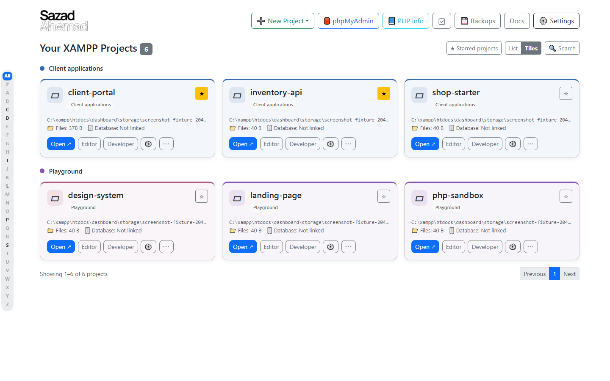
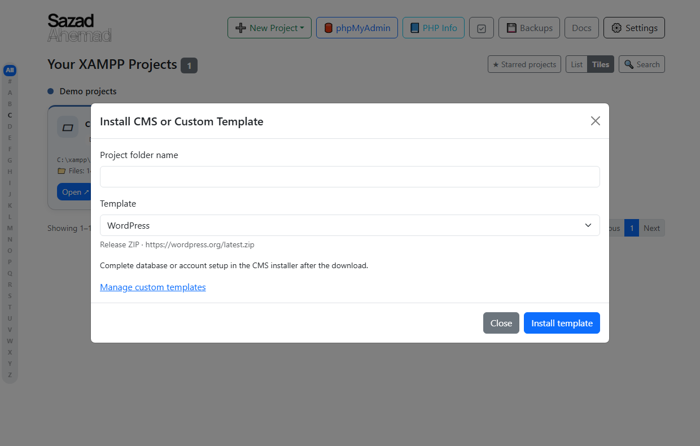
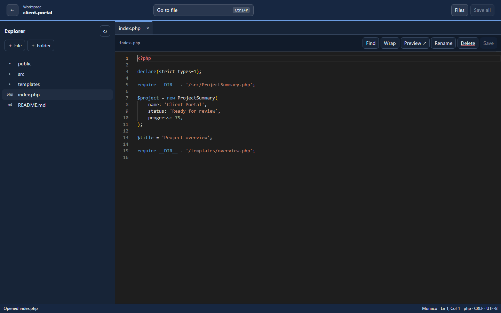
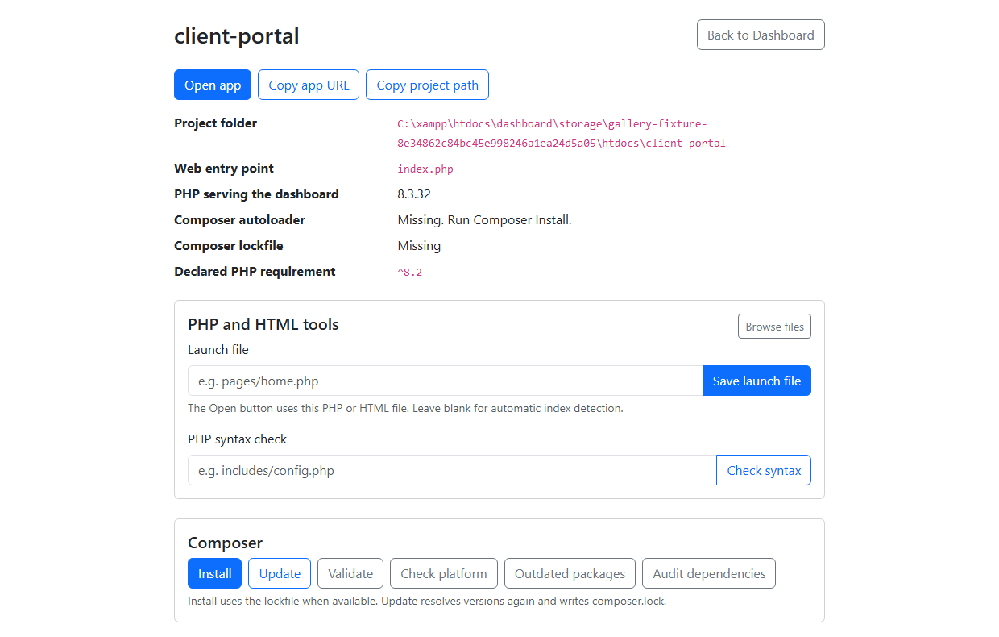
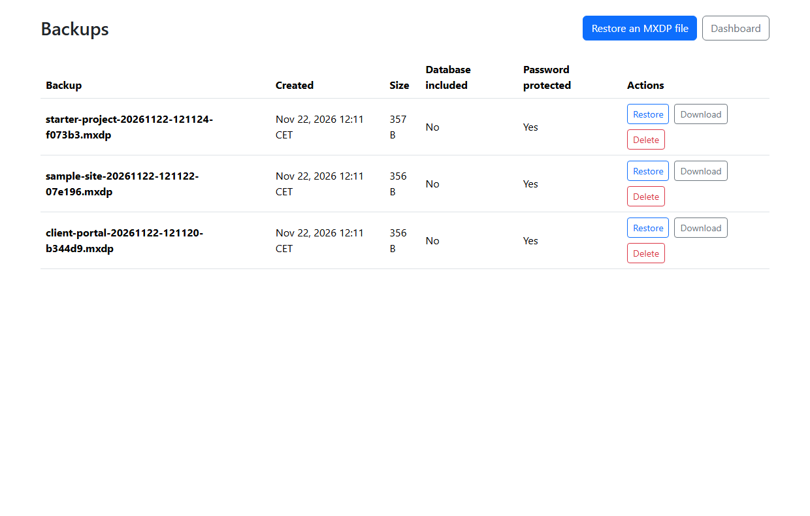
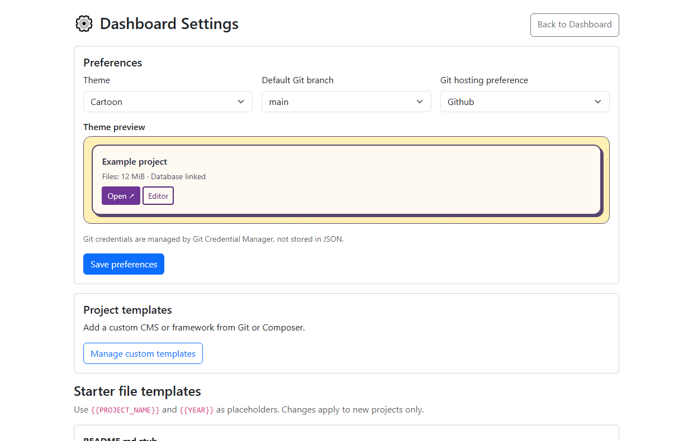

# Modern XAMPP Dashboard

A browser-based project manager for local PHP development. Start a WordPress site or framework project, open an existing Git repository, edit files, run Composer, and back up projects with their linked databases from one dashboard.

## Quick start

1. Place this repository in a `dashboard` folder inside your Apache document root, alongside your projects. Keep its `.htaccess` files.
2. Start **Apache**. Start **MySQL** or **MariaDB** if you need database features.
3. Open [localhost/dashboard](http://localhost/dashboard/) using the port configured for Apache. Supported sibling project folders appear automatically.
4. Use **New Project** to create, clone, install, or import a project. Click **Open** on a project card to launch the app.

The dashboard is designed for local Apache and PHP 8.2 or newer on Windows, macOS, or Linux. Git, Composer, VS Code, and PHP extensions are required only by the features that use them. The [setup guide](docs/SETUP_AND_TROUBLESHOOTING.md) covers prerequisites, common errors, and custom project paths.

## Explore the dashboard

### Organize and open local projects

Switch between **List** and **Tiles**, search by project name, or use the alphabet rail. Star frequently used projects and group related folders with shared colors. A project can also have its own card color and notes.

Each card provides quick access to the app, browser editor, Developer tools, and settings. The action menu opens the folder or VS Code, links to connected databases in phpMyAdmin, and handles exports and removal. File and database sizes load after the project list renders.

### Scaffold frameworks, install a CMS, or clone a repository

**New Project** supports blank PHP starters, Git initialization, HTTPS Git cloning, and starter templates for Laravel, Yii 2 Basic, CakePHP, Symfony, and CodeIgniter 4. The dashboard detects a framework's public entry point so **Open** can send you to directories such as `public/`, `web/`, or `webroot/`.

**Install CMS or Custom Template** shows the source and streams progress. Once the files are installed, use **Open** or follow the template's setup instructions to finish configuring the CMS.

| Install method | Built-in CMS templates |
| --- | --- |
| Release ZIP | WordPress, Joomla, Grav |
| Composer | Drupal, Drupal CMS, Craft CMS, Kirby, Statamic, Concrete CMS, Silverstripe CMS, October CMS, TYPO3 |
| HTTPS Git | ProcessWire, Backdrop CMS |

Save reusable **custom CMS or framework templates** in Settings. A template can use an HTTPS Git repository or a Composer package. You can specify a branch, tag, or version, set its public folder, and optionally install Composer dependencies after a Git clone.

### Edit projects in the browser

The workspace has an expandable Explorer, closeable tabs, syntax highlighting, and an indicator for unsaved changes. Create files and nested folders in the same dialog, rename entries, and preview saved PHP or HTML pages.

- **Ctrl+P** finds a file by name or path.
- **Ctrl+S** saves the active tab. **Ctrl+Shift+S** saves all edited tabs.
- **Ctrl+F** finds text in the current file.

The editor keeps drafts when you switch tabs and rejects saves that would overwrite a newer on-disk version. It falls back to plain text if Monaco cannot load.

### Diagnose projects and run Composer

The **Developer** panel shows the public entry point, PHP version, Composer lockfile and autoloader status, and missing declared PHP extensions. You can copy the app URL, project path, or terminal commands. Plain projects can also set a custom PHP or HTML launch file and run a PHP syntax check.

For Composer projects, run **Install**, **Update**, **Validate**, **Check platform**, **Outdated packages**, or **Audit dependencies** and read the output in the browser. Project Settings can initialize Git on an existing project and reads the origin directly from the repository.

### Back up projects and restore databases

Create password-protected **MXDP** backups of project files and linked databases, or choose a database-only backup. The **Backups** page shows creation time, size, database inclusion, and protection. From there you can download, restore, or delete a saved archive.

Use **Download ZIP + DB** when you need an unencrypted ZIP export. Use **New Project** to restore an MXDP or import a ZIP, or drop one archive onto the dashboard. After an import or Git clone, the database setup dialog can restore selected SQL files into new databases and link them to the project. See the [backup and database guide](docs/BACKUPS_AND_DATABASES.md) for password, archive, and database requirements.

### Make the workspace yours

Preview a theme in Settings before saving. The catalog includes Blueprint, Vista Glass, iOS Frost, Cartoon, Windows XP, Deep Ocean, and more. Customize starter files for future projects and use the header's to-do button for a browser-local checklist.

## Documentation

Open **Docs** in the dashboard to read the HTML guides in XAMPP.

| Guide | What it covers |
| --- | --- |
| [User guide](docs/USER_GUIDE.md) | Project creation, CMS and frameworks, editing, Git, Composer, layout, themes, and to-dos |
| [Backups and databases](docs/BACKUPS_AND_DATABASES.md) | MXDP and ZIP formats, restore, SQL import, and safe deletion |
| [Setup and troubleshooting](docs/SETUP_AND_TROUBLESHOOTING.md) | Prerequisites, permissions, configuration, and common errors |
| [Maintainer reference](docs/MAINTAINER_REFERENCE.md) | Code layout, storage, endpoints, and verification |
| [Upgrade guide](UPGRADE.md) | Preserving settings, templates, and backups during updates |

Run the dashboard on a trusted local machine. The screenshots use sample projects.

Created by [connect2sazad](https://connect2sazad.github.io/).
